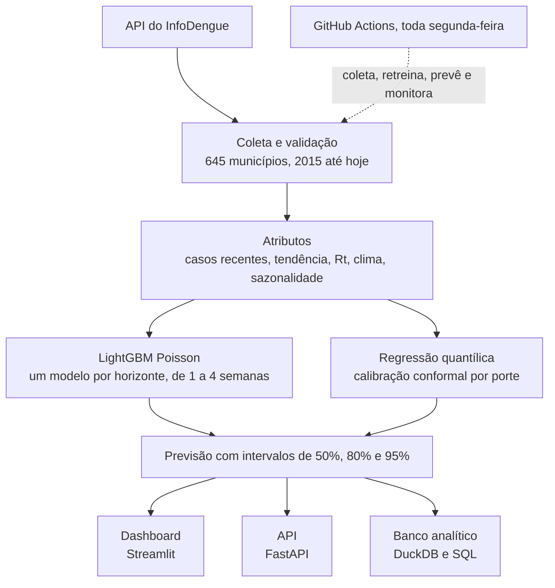

# 🦟 Radar Dengue SP

Previsão semanal de casos de dengue para os 645 municípios de São Paulo, de 1 a 4 semanas à frente, em produção e atualizada automaticamente.

**[Dashboard](https://radar-dengue-gsqumy4teckmjnzgugdd97.streamlit.app/)** · **[Análises](notebooks)** · **[Fundamentos teóricos](docs/teoria)** · **[Consultas SQL](sql)** · **[API](src/radar_dengue/api.py)**


## Em resumo

- **Problema:** secretarias de saúde precisam saber com semanas de antecedência onde a dengue vai aumentar, para reforçar o combate ao mosquito e preparar o atendimento.
- **Solução:** um modelo LightGBM com função de perda de Poisson, treinado com 12 anos de dados do InfoDengue (Fiocruz/FGV), que prevê os casos de cada município com intervalos de incerteza calibrados.
- **Resultado:** erra de **13% a 29% menos** que repetir a semana atual e, combinado com o alerta oficial do InfoDengue, identifica com 4 semanas de antecedência **88% dos municípios que entram em nível epidêmico**, contra 74% do alerta sozinho. Num backtest de 8 temporadas (2019–2026), vence o baseline em todas, no erro e na qualidade dos intervalos.

## Resultados

Avaliação em 2024–2026, período que o modelo nunca viu no treino e que inclui a maior epidemia de dengue da história do estado.

| | |
|---|---|
| **Precisão** | Erro de 11,6 casos por município-semana com 1 semana de antecedência e 26,0 com 4 semanas, contra 13,4 e 36,6 do baseline. A diferença é estatisticamente significativa com 2 a 4 semanas (teste de Diebold-Mariano, p ≤ 0,010 na escala log); com 1 semana, o ganho é pequeno e não significativo (p ≈ 0,07). |
| **Várias temporadas** | Backtest com origem móvel de 2019 a 2026: em cada ano, o modelo é treinado só com o passado. Erra 18% menos que o baseline e tem WIS (*weighted interval score*, a métrica do CDC e do desafio Infodengue-Mosqlimate) 29% menor, melhor em todas as 8 temporadas e nos 4 horizontes. |
| **Comparação** | Venceu cinco alternativas, incluindo a binomial negativa, referência estatística para contagens, que fica perto só com 3 e 4 semanas. Um SARIMAX ajustado em cada uma das 82 cidades grandes perdeu até do baseline com 1 a 3 semanas: na epidemia de 2024, ele puxava a previsão de volta ao padrão sazonal. |
| **Alerta oficial** | O alerta do InfoDengue é melhor para dizer quem continua em epidemia; o modelo antecipa cerca de metade das novas epidemias. Os dois juntos detectam mais, ao custo de mais alarmes falsos. |
| **Incerteza** | Intervalos de 50%, 80% e 95% com calibração conformal por porte do município: o de 95% cobre 94,6% dos valores reais, e nas cidades com mais de 500 mil habitantes, 96,4% (eram 91,0% com um ajuste único). No backtest, os de 80% e 95% cobrem em média 81% e 95%. |
| **Clima** | Controlando a época do ano, cada +1 °C se associa a só 4% a 7% mais casos, no curto prazo (associação observacional). A correlação forte vista nos dados brutos era sazonal. |
| **Epidemia de 2024** | Foi recorde porque atingiu o leste do estado, que tinha pouca dengue: incidência quase 9 vezes maior que em 2023. |
| **Ponto fraco** | Subestima o início das epidemias; reconhece bem o fim. Casos dos municípios vizinhos e a tendência do Rt anteciparam mais inícios na validação, mas não melhoraram o erro no backtest e pioraram 2024; ficaram fora do modelo. |

## O que o projeto demonstra

- **Modelagem de séries temporais:** validação temporal sem vazamento, backtest com origem móvel, comparação com baselines e modelos estatísticos, ajuste de hiperparâmetros, análise de erros e experimentos com atributos descartados quando não se sustentaram.
- **Estatística aplicada:** regressão binomial negativa com efeitos fixos, SARIMAX com sazonalidade de Fourier, teste de Diebold-Mariano, regressão quantílica, calibração conformal por grupo (*Mondrian*), WIS, valores SHAP.
- **Engenharia de dados:** coleta via API, validação, banco analítico em DuckDB com consultas SQL (funções de janela, CTEs).
- **Produção:** atualização semanal pelo GitHub Actions, registro de versões do modelo, monitoramento do desempenho com alerta, API em FastAPI, dashboard em Streamlit, Docker, 38 testes automatizados.

## Como funciona



## Análises

| Notebook | Pergunta |
|---|---|
| [01 · Descritiva](notebooks/01_analise_descritiva.ipynb) | Como a dengue se comporta no tempo, no espaço e com o clima? |
| [02 · Inferencial](notebooks/02_analise_inferencial.ipynb) | O clima importa além da sazonalidade? O modelo é significativamente melhor? |
| [03 · Modelagem](notebooks/03_modelagem_e_avaliacao.ipynb) | Qual método prevê melhor, onde ele erra e quão confiáveis são os intervalos? Como se compara ao alerta oficial? |
| [04 · SQL](notebooks/04_consultas_sql.ipynb) | As mesmas perguntas respondidas em SQL, num banco analítico. |

A pasta [`docs/teoria`](docs/teoria) explica cada método usado (gradient boosting, perda de Poisson, binomial negativa, regressão quantílica e calibração conformal, SHAP, Diebold-Mariano, SARIMAX), com a formulação, o motivo da escolha e as hipóteses que podem falhar neste projeto.

## Decisões técnicas

- **Validação temporal:** treino até 2023, teste a partir de 2024, e um backtest em que cada ano de 2019 a 2026 é previsto só com os anos anteriores. Embaralhar os dados deixaria o modelo ver o futuro.
- **Hiperparâmetros escolhidos com o modelo de produção:** a busca usa a mesma perda de Poisson com *offset*, nos quatro horizontes, e só os anos de 2021 a 2023. As configurações ficam a menos de 1% umas das outras.
- **Prever a variação, não o nível:** árvores não extrapolam; prevendo o nível, o modelo subestimou a epidemia de 2024. Com a semana atual como *offset*, passou a acompanhar epidemias de qualquer tamanho.
- **Perda de Poisson:** própria para contagens; reduziu o erro em até 5% em relação a prever o logaritmo (de 0,4% a 4,8%, conforme o horizonte).
- **Atraso de notificação:** na semana mais recente, só cerca de 28% dos casos já estão notificados. Essas semanas ficam fora da avaliação e, na previsão, usam o nowcast do InfoDengue.
- **Um modelo para todos os municípios:** cidades pequenas, com poucos casos, aprendem com o padrão das grandes.

## Limitações

- O teste usa os **casos já consolidados**; em tempo real, a semana atual depende de uma estimativa (nowcast) com erro. Numa simulação, isso aumenta o erro de curto prazo, mas o modelo continua melhor que o baseline.
- Avaliado em **um estado**, em oito temporadas; o desempenho em outros estados não foi testado.
- **Casos notificados**, não confirmados, como na vigilância.
- Sem informação de **sorotipo e vacinação**. Os níveis de risco são ilustrativos.

## Rodando localmente

Requer Python 3.11+.

```bash
git clone https://github.com/luishenrique1702/radar-dengue.git
cd radar-dengue
python -m venv .venv && source .venv/bin/activate   # Windows: .venv\Scripts\activate
make install    # dependências
make pipeline   # coleta, treina, prevê, monitora e cria o banco SQL (~15 min)
make backtest   # backtest de 2019 a 2026, com WIS (~1 h)
make app        # dashboard em http://localhost:8501
make api        # API em http://localhost:8000/docs
make testes
```

## Estrutura

```
├── app/                 dashboard (Streamlit)
├── notebooks/           análises descritiva, inferencial, de modelagem e SQL
├── sql/                 consultas analíticas
├── src/radar_dengue/    coleta, validação, atributos, modelos, ajuste, backtest, experimentos,
│                        intervalos, previsão, monitoramento, comparação, banco SQL e API
├── tests/               38 testes
└── .github/workflows/   testes a cada mudança e atualização semanal
```

## Dados

[InfoDengue](https://info.dengue.mat.br) (Fiocruz/FGV): casos semanais, nowcast, Rt, nível de alerta e clima por município, 2015–2026, cerca de 398 mil registros. Malha municipal do IBGE via [geodata-br](https://github.com/tbrugz/geodata-br). Trabalhos relacionados: o [desafio de previsão Infodengue-Mosqlimate](https://sciety.org/articles/activity/10.1101/2025.05.12.25327419) e o [modelo por bairros do Rio de Janeiro](https://agencia.fapesp.br/modelo-de-aprendizado-de-maquina-pode-ser-utilizado-para-prever-surtos-de-dengue/39217/) (USP/UFABC/FGV).

## Autor

**Luis Henrique Toledo** · Doutorando em Probabilidade e Estatística · IME-USP · [LinkedIn](https://www.linkedin.com/in/luis-henrique-toledo-057b49161/) · [Lattes](https://buscatextual.cnpq.br/buscatextual/visualizacv.do?id=K1107936U3)
