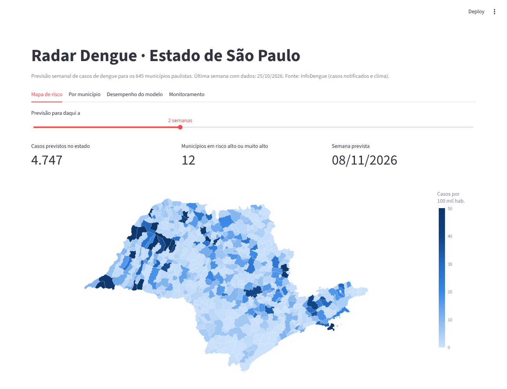

# 🦟 Radar Dengue SP

**Previsão semanal de casos de dengue para os 645 municípios do estado de São Paulo, de 1 a 4 semanas à frente, com mapa de risco, intervalos de previsão e monitoramento contínuo do modelo.**

🔗 **Dashboard:** [radar-dengue.streamlit.app](https://radar-dengue-gsqumy4teckmjnzgugdd97.streamlit.app/)



---

## Objetivo

**Antecipar onde a dengue vai aumentar, para que a vigilância em saúde possa agir antes dos casos
subirem.** O projeto responde a três perguntas:

| Pergunta | Resposta |
|---|---|
| 1. Dá para prever os casos de cada município com até 4 semanas de antecedência melhor do que repetindo a semana atual? | **Sim.** O erro cai 9% (1 semana) a 28% (4 semanas), com significância estatística. |
| 2. O clima ajuda a prever, além do que a época do ano já explica? | **Muito pouco.** Controlando a sazonalidade, +1 °C se associa a só 4% a 7% mais casos, no curto prazo. |
| 3. Onde e quando o modelo falha? | **No início das epidemias e nas cidades pequenas.** Ele reconhece bem o fim de uma epidemia, mas subestima a aceleração. |

## O problema

A dengue é a arbovirose de maior impacto no Brasil. Em 2024, o estado de São Paulo registrou
cerca de **3,9 milhões de casos notificados**, a maior epidemia da série histórica. Secretarias de
saúde precisam decidir **com semanas de antecedência** onde reforçar o combate ao mosquito, abrir
salas de hidratação e remanejar equipes.

**Pergunta de negócio:** *quantos casos cada município terá nas próximas 4 semanas, e quais estão
caminhando para um nível de risco alto?*

## Principais resultados

| | |
|---|---|
| **Desempenho** | O modelo erra **9% a 28% menos** que o baseline ingênuo (repetir a semana atual), com ganho crescente com o horizonte. |
| **Significância** | A melhora é estatisticamente significativa na escala log em todos os horizontes (teste de Diebold-Mariano, p < 0,01). |
| **Comparação** | Regressão linear e "repetir o ano anterior" perdem até do baseline: as relações são não lineares. |
| **Incerteza** | Intervalos de 80% cobrem 76% dos valores reais no teste. |
| **Clima** | Controlando a época do ano, cada +1 °C se associa a só 4% a 7% mais casos, no curto prazo. A correlação forte vista nos dados brutos era quase toda sazonal. |
| **Epidemia de 2024** | Foi recorde porque atingiu o Leste do estado (capital, Vale do Paraíba, litoral), historicamente pouco afetado: incidência quase 9 vezes maior que em 2023. |

### Desempenho por horizonte (teste em 2024–2026, nunca visto no treino)

| Horizonte | Erro médio, modelo | Erro médio, baseline | Redução | Precisão do alerta* |
|:--:|:--:|:--:|:--:|:--:|
| 1 semana | 12,2 casos | 13,4 | **-9%** | 91% |
| 2 semanas | 18,1 | 21,4 | **-16%** | 90% |
| 3 semanas | 22,2 | 29,2 | **-24%** | 89% |
| 4 semanas | 26,4 | 36,6 | **-28%** | 87% |

\* Dos municípios-semana classificados como risco alto ou muito alto, quantos realmente atingiram
esse nível. O *recall* (71% a 81%) é um pouco menor que o do baseline: o modelo é mais certeiro, mas
mais conservador.

## Análises

Os três notebooks em [`notebooks/`](notebooks) contam a história completa, com código e interpretação:

| Notebook | Conteúdo |
|---|---|
| [01 · Análise descritiva](notebooks/01_analise_descritiva.ipynb) | Qualidade dos dados, atraso de notificação, evolução 2015–2026, sazonalidade, porte e região, distribuição, clima |
| [02 · Análise inferencial](notebooks/02_analise_inferencial.ipynb) | Regressão binomial negativa com efeitos fixos (clima × dengue) e teste de Diebold-Mariano (modelo × baseline) |
| [03 · Modelagem e avaliação](notebooks/03_modelagem_e_avaliacao.ipynb) | Comparação de 4 métodos, ajuste de hiperparâmetros, erros por porte, região e fase da epidemia, SHAP, regressão quantílica |

## Como funciona

```
InfoDengue API ──► coleta (645 municípios, 2015–hoje) ──► validação dos dados
                                                                │
                          engenharia de atributos (só passado, sem vazamento)
                                                                │
          LightGBM por horizonte (1–4 semanas): previsão central + quantis 10% e 90%
                                                                │
          previsão atual com correção do atraso de notificação (nowcast)
                                                                │
          ┌──────────────────────┬──────────────────────────────┴──────┐
          ▼                      ▼                                     ▼
   Dashboard Streamlit   registro de versões do modelo     log de previsões → monitoramento
                                                                       │
                    GitHub Actions: tudo isso automaticamente toda segunda-feira,
                    com alerta por e-mail se o modelo ficar pior que o baseline
```

### Decisões de modelagem

- **Validação temporal, não aleatória.** Treino até 2023, teste a partir de 2024. Embaralhar os dados
  deixaria o modelo "espiar o futuro".
- **Prever a variação, não o nível.** Árvores de decisão não extrapolam: prevendo o número de casos
  diretamente, o modelo subestimou a epidemia de 2024 e perdeu do baseline. Prevendo a variação em
  relação à semana atual, passou a acompanhar epidemias de qualquer tamanho.
- **Escala logarítmica**, porque os casos vão de zero a dezenas de milhares e a distribuição é
  extremamente assimétrica.
- **Atraso de notificação.** Na semana mais recente desta base, só 28% dos casos estimados já
  estavam notificados. As últimas semanas ficam fora da avaliação e, na previsão, usam o *nowcast*
  do InfoDengue.
- **Um modelo global para todos os municípios**: cidades pequenas, com poucos casos, aprendem com
  o padrão das grandes.
- **Hiperparâmetros:** a busca com validação cruzada temporal mudou o erro em menos de 2%. O ganho
  vem dos atributos e do desenho do alvo.

## Produção

| Peça | O que faz |
|---|---|
| `validate.py` | Para o pipeline se a API mudar de formato, vier incompleta ou com valores inválidos |
| `model.py` | Treina, avalia e **registra cada versão** com suas métricas em `models/registro/versoes.csv` |
| `predict.py` | Gera a previsão atual com **intervalo de 80%** e a salva no histórico de previsões |
| `monitor.py` | Compara previsões passadas com o que aconteceu; falha (e o GitHub avisa por e-mail) se o modelo ficar pior que o baseline por 4 semanas |
| `atualizar.yml` | GitHub Actions: coleta, treino, previsão e monitoramento toda segunda-feira |
| `ci.yml` | Lint e 22 testes a cada mudança no código |

Modelos treinados e dados brutos não vão para o repositório: são regenerados a cada execução,
para o histórico do Git não crescer toda semana.

## Dados

| Fonte | Conteúdo |
|---|---|
| [InfoDengue](https://info.dengue.mat.br) (Fiocruz/FGV) | Casos notificados semanais, nowcast, Rt, temperatura e umidade por município |
| [geodata-br](https://github.com/tbrugz/geodata-br) | Malha dos municípios de SP (IBGE) |

~398 mil registros (645 municípios × 617 semanas, jan/2015 a out/2026).

## Rodando localmente

Requer Python 3.11+.

```bash
git clone https://github.com/luishenrique1702/Radar-Dengue.git
cd Radar-Dengue
python -m venv .venv && source .venv/bin/activate   # Windows: .venv\Scripts\activate
make install    # ou: pip install -e ".[dev,analise]"

make pipeline   # coleta, treina, prevê e monitora (~8 min)
make app        # dashboard em http://localhost:8501
make testes
```

Com Docker: `docker build -t radar-dengue . && docker run -p 8501:8501 radar-dengue`

## Estrutura

```
├── app/streamlit_app.py      # dashboard (mapa, municípios, desempenho, monitoramento)
├── notebooks/                # análises descritiva, inferencial e de modelagem
├── src/radar_dengue/
│   ├── collect.py            # coleta via API do InfoDengue
│   ├── validate.py           # checagens de qualidade dos dados
│   ├── features.py           # atributos e níveis de risco
│   ├── geo.py                # região e porte dos municípios
│   ├── model.py              # treino, avaliação e registro de versões
│   ├── predict.py            # previsão atual com intervalos
│   └── monitor.py            # desempenho em produção e alerta
├── tests/                    # 22 testes
├── data/                     # malha, dados processados e monitoramento
├── models/                   # métricas e registro de versões
└── .github/workflows/        # CI e atualização semanal
```

## Trabalhos relacionados

Previsão de dengue no Brasil é uma área de pesquisa ativa. Este projeto se apoia nos dados e no
nowcast do [InfoDengue](https://info.dengue.mat.br). O consórcio Infodengue-Mosqlimate organizou em
2024 um [desafio de previsão](https://sciety.org/articles/activity/10.1101/2025.05.12.25327419)
cujos modelos combinados foram usados pelo Ministério da Saúde. Pesquisadores da USP, UFABC e FGV
[previram surtos por bairro no Rio de Janeiro](https://agencia.fapesp.br/modelo-de-aprendizado-de-maquina-pode-ser-utilizado-para-prever-surtos-de-dengue/39217/)
com árvores de decisão explicáveis.

## Limitações

- **Casos notificados ≠ confirmados.** Seguimos a métrica da vigilância, que inclui casos prováveis.
- **Cidades muito pequenas** têm incidência instável e erro relativo alto.
- **O modelo subestima subidas fortes**, o erro mais caro para a vigilância.
- **Intervalos estreitos demais nas cidades grandes** (cobertura de 63% contra 80% nominais).
- Sem informação de **sorotipo** e **vacinação**. Níveis de risco ilustrativos, que não substituem
  boletins oficiais.

## Próximos passos

- [ ] Casos nos municípios vizinhos como atributo, para antecipar subidas
- [ ] Calibração dos intervalos (*conformal prediction*)
- [ ] Limiar de alerta priorizando *recall*
- [ ] Estudo causal: efeito da vacinação (iniciada em 2024), por diferenças em diferenças

## Autor

**Luis Henrique Toledo** · Doutorando no IME-USP · Monitor no Insper · [LinkedIn](https://www.linkedin.com/in/luis-henrique-toledo-057b49161/) · [Lattes](https://buscatextual.cnpq.br/buscatextual/visualizacv.do?id=K1107936U3)
